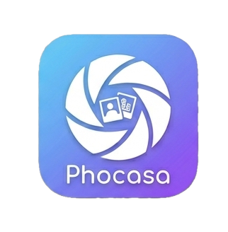
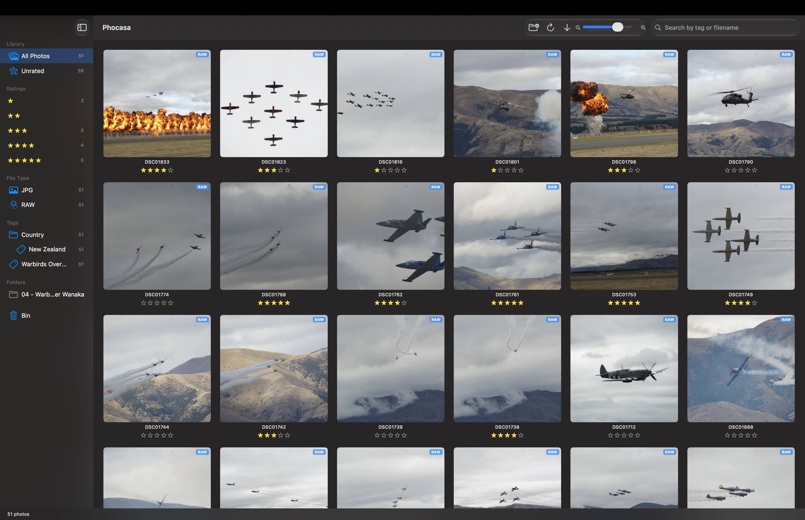
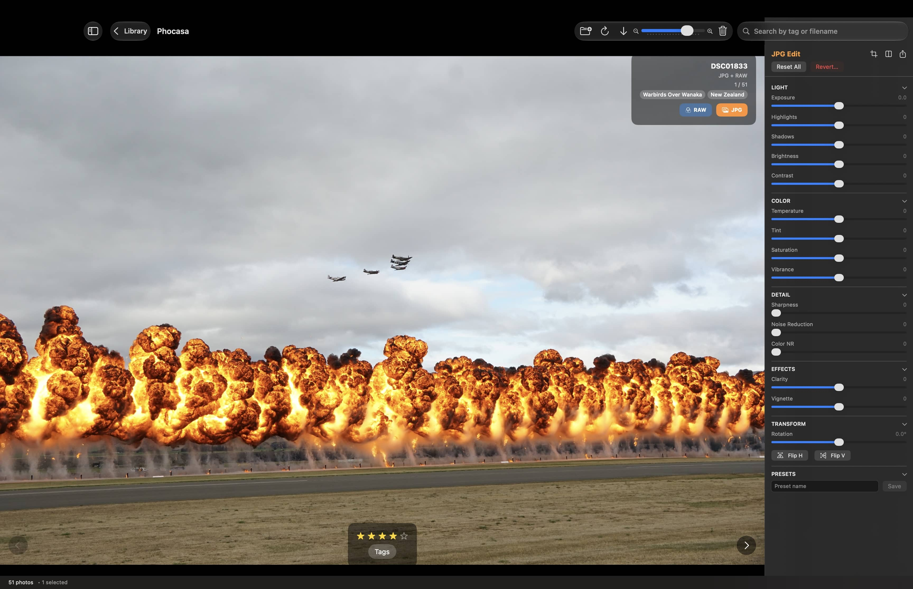

# Phocasa

A fast, native macOS app for browsing, rating, tagging and editing large photo collections, right where they already
live on disk. It's local-only, leaves your folders as they are, and records everything in the files' own metadata and
sidecars, so your data stays portable.





## What makes it different

- **No import.** Point it at your folders and it works on the files in place: nothing is copied or moved. External
  drives work too: an unplugged drive's photos are hidden until it's back, and folders you move or rename are found
  again.
- **Your ratings and tags live in your files.** Star ratings and keywords are written into JPEG, PNG, TIFF and HEIC
  files as standard XMP/IPTC, and into `.xmp` sidecars for RAW files, so Lightroom, Bridge, Capture One and others can
  read them. Phocasa only ever adds to a file's metadata: it never strips or rewrites the camera's Exif, GPS or
  existing XMP.
- **RAW + JPG as one photo.** Pairs shot together show up once. Filter to either format, or drop the RAW or the JPG
  from a whole set of pairs.
- **Built for big libraries.** Tested with 150,000 photos. Filtering, search and counts happen in memory, and
  thumbnails are cached on disk, so it stays responsive.
- **Non-destructive editing.** Exposure, highlights and shadows, white balance, vibrance, clarity, sharpening, noise
  reduction, crop and rotation, with presets. RAW files go through Apple's RAW engine, and JPEG exports keep the
  original metadata.
- **Native and private.** Swift and SwiftUI, Apple frameworks only: no third-party dependencies, no network access, no
  account.



Also included: hierarchical tags (`category:name`), filters by rating, tag and file type, search, a bin with restore,
undo and redo, and a daily backup of the library database.

## Requirements

- macOS 14 (Sonoma) or later
- Xcode 16 or later (to build)

## Build and install

```bash
git clone https://github.com/ro-savage/phocasa.git
cd phocasa/Phocasa
xcodebuild -project Phocasa.xcodeproj -scheme Phocasa -configuration Release -derivedDataPath DerivedData build
ditto DerivedData/Build/Products/Release/Phocasa.app /Applications/Phocasa.app
```

Then open Phocasa from Applications and choose **File › Open Folder…** (⌘O).

If `xcodebuild` says it needs Xcode rather than the Command Line Tools, run `sudo xcode-select -s /Applications/Xcode.app`
first. You can also open `Phocasa/Phocasa.xcodeproj` in Xcode and press ⌘R.

Phocasa keeps its library database in `~/Library/Application Support/Phocasa/`. Your photos are never stored there.

## Development

```bash
cd Phocasa
xcodebuild -project Phocasa.xcodeproj -scheme Phocasa -destination 'platform=macOS' test
```

Architecture, design decisions and project conventions are in [CLAUDE.md](CLAUDE.md).

## License

[MIT](LICENSE)
